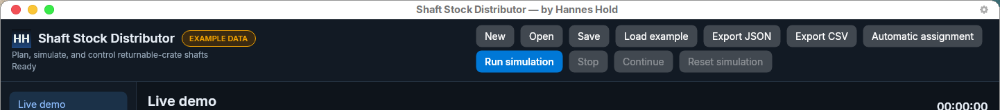
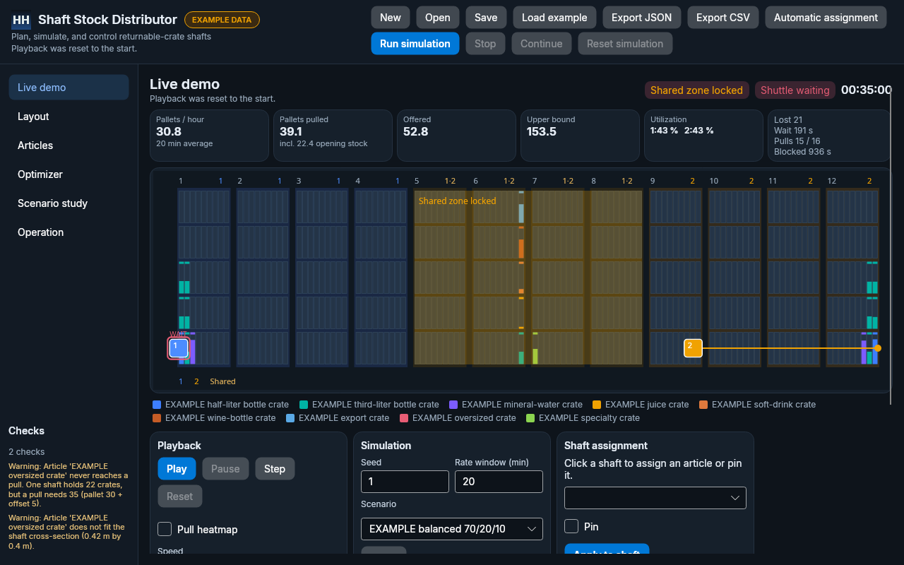
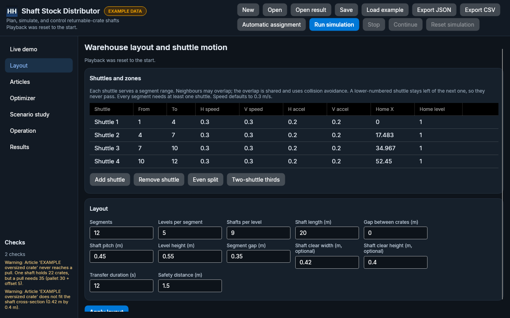
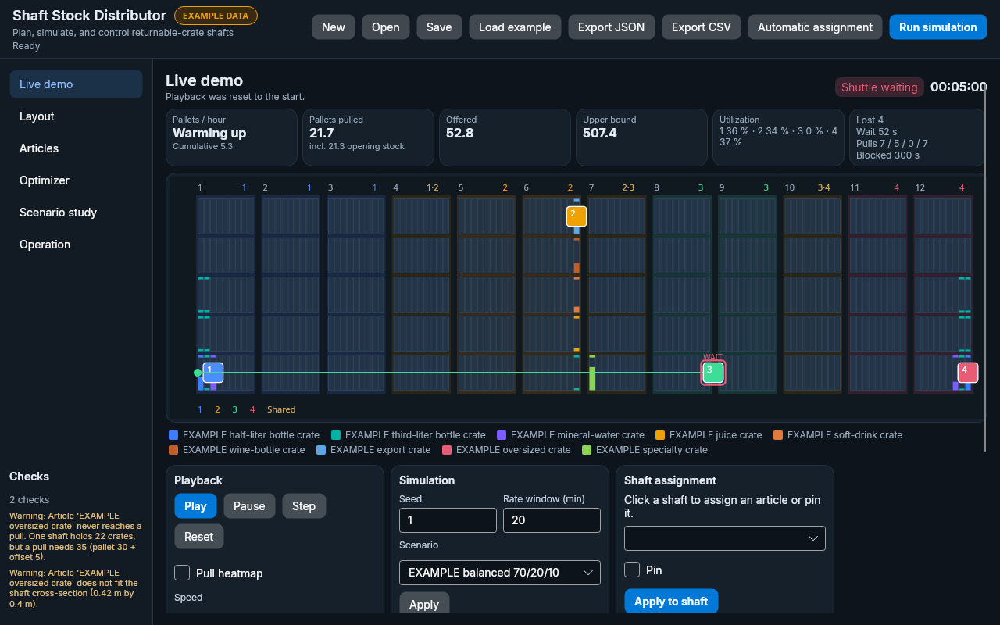
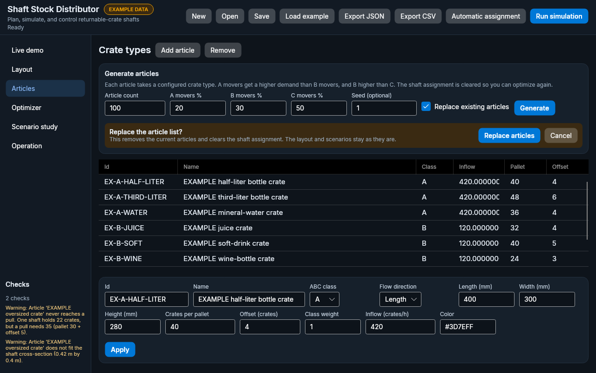
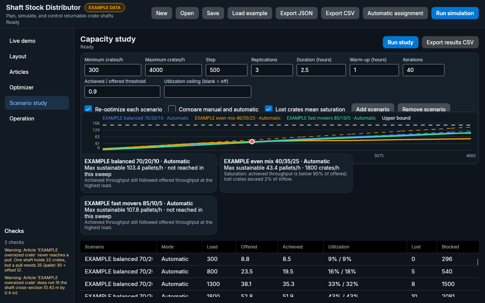

# Shaft Stock Distributor

Shaft Stock Distributor plans which returnable-crate article belongs in which shaft of a flow-rack aisle, then simulates the shuttles that pull those shafts. By Hannes Hold. The same operations core drives the animated demo and the scenario study, and it is the surface a future PLC adapter would call.

The desktop app is Avalonia 11 (11.3.22) on .NET 10. Headless rendering and the chart library both work, so the UI stayed on Avalonia. The window title is “Shaft Stock Distributor — by Hannes Hold”. The application icon is the HH mark.

All copy in the app, the sample, the logs, and these docs is English.

## What the demo shows

Run simulation plays the project that is already open: its layout, articles, assignment, and mode. It does not reload the example warehouse. If the stored assignment no longer matches the layout (a shaft is missing, duplicated, or points at an unknown article), that same project is optimized again and then played. Load example is a separate action. It asks before replacing a project that has unsaved changes. The first launch still opens the example warehouse.

On the Articles page, Generate articles builds a catalog from the configured crate types. You set a count, the percentage of A, B, and C movers (they must add up to 100%), whether to replace or append, and an optional seed. Each article gets an English name, a crate type (dimensions and crates per pallet), and a demand share that keeps every A mover above every B mover and every B mover above every C mover. Generating clears the shaft assignment so you can run the optimizer. It does not load the example.

Editing an article's inflow and pressing Apply writes that rate onto the project. If the change was typed into the grid, Apply commits the cell first instead of putting the old draft back. Playback restarts so arrivals use the new rate, and the status line names the article. Re-optimizing the shaft plan stays a separate step.

The aisle itself:

- Shafts fill in the article color. A pull drains the shaft.
- Shuttles move with the acceleration profile, horizontally and between levels at the same time.
- Shared overlaps lock, and a shuttle that has to wait is drawn with a WAIT marker. Every shuttle on the aisle is animated.
- Playback is play, pause, step, and reset on the Live demo page, from 1x to 400x. The header adds Run simulation, Stop, Continue, and Reset simulation beside each other. Stop pauses, Continue resumes the same run, and Reset returns to the start without loading the example. While a run is going or paused, the layout, articles, zones, optimizer, and other project edits stay locked until you reset.
- The live dashboard shows pallets per hour, offered pallets per hour, utilization, pull wait, blocked time, and lost crates.

The Layout page edits the rack and a shuttle table: segment from/to, speed (default 0.3 m/s), and home. Add or remove shuttles (one up to the segment count), apply an even split, or restore the two-shuttle thirds preset. The rack paints each shuttle's exclusive segments and the shared overlaps. The operation page shows the pull queue, the event log, and every shuttle's state. Switching manual and automatic assignment asks for confirmation first.

## Screenshots

The desktop window title is “Shaft Stock Distributor — by Hannes Hold”. The HH mark is the application icon and the header mark.



Headless Skia captures of the main window. `live-demo.png` is the two-shuttle aisle at 1280×800 after the shuttles have started to move. `live-demo-wide.png` is the same view at 1920×1080. `shuttles-zones.png` is the Layout page with the shuttle table. `live-demo-four-shuttles.png` is the same aisle after an even split into four shuttles. `article-generator.png` is the Articles page with the generator asking before a replace.











## Projects

| Project | Role |
| --- | --- |
| `ShaftStockDistributor.Core` | Layout, articles, zones, travel time, validation, JSON |
| `ShaftStockDistributor.Optimizer` | Shaft counts, constructive heuristic, simulated annealing |
| `ShaftStockDistributor.Operations` | Pull controller, aisle interlock, automatic reassignment, hardware port |
| `ShaftStockDistributor.Simulation` | Seeded discrete-event simulation and the scenario study |
| `ShaftStockDistributor.Cli` | `shaftstock` sample, optimize, simulate, study |
| `ShaftStockDistributor.Desktop` | Avalonia UI, MVVM, animated aisle, charts |
| `ShaftStockDistributor.Tests` | Domain, optimizer, controller, simulation |
| `ShaftStockDistributor.Desktop.Tests` | View-model tests and headless window renders |

View models use CommunityToolkit.Mvvm (`ObservableProperty`, `RelayCommand`, `ObservableValidator`) and a messenger for project and simulation events. Services (storage, file dialogs, optimizer, study, clock) sit behind interfaces. Bindings are compiled. Strings live in `Resources/Strings.resx`.

## Run

Install the .NET 10 SDK (the repo pins 10.0.402, rolling forward on the 10.0 feature band).

```bash
dotnet run --project src/ShaftStockDistributor.Desktop
```

Published builds are framework-dependent. The machine needs the .NET 10 desktop runtime.

```bash
dotnet publish src/ShaftStockDistributor.Desktop -c Release -r linux-x64 --self-contained false
dotnet publish src/ShaftStockDistributor.Desktop -c Release -r win-x64 --self-contained false
```

Command line:

```bash
dotnet run --project src/ShaftStockDistributor.Cli -- sample --out samples/example-warehouse.json
dotnet run --project src/ShaftStockDistributor.Cli -- optimize --project samples/example-warehouse.json
dotnet run --project src/ShaftStockDistributor.Cli -- simulate --project samples/example-warehouse.json --hours 2.5 --warmup 1 --seed 1 --mode Manual
dotnet run --project src/ShaftStockDistributor.Cli -- study --project samples/example-warehouse.json --compare-modes --csv samples/example-study.csv
```

`--no-optimize` keeps the assignment already stored in the file. The study re-optimizes once per scenario unless you pass that flag.

## Example data

`samples/example-warehouse.json` is hypothetical and labeled EXAMPLE. It is a 12 × 5 × 9 aisle, shaft length 20 m, pitch 0.45 m, level height 0.55 m, segment gap 0.35 m, transfer 12 s, safety distance 1.5 m. Shuttle speed is 0.3 m/s and acceleration is 0.2 m/s² on both axes. Three scenarios each total 1800 crates/h: balanced 70/20/10, fast movers 85/10/5, and even mix 40/35/25.

`EX-C-OVERSIZE` is 900 × 800 × 800 mm. It is in the catalog so the layout warns that a pull can never trigger and that the crate does not fit the optional 0.42 m × 0.40 m cross-section. Its class weight is 0, so it receives no inflow and does not trip saturation by itself.

## Project file

JSON schema version 1, camelCase, enums as strings, shaft addresses 1-based (`segment`, `level`, `shaft`). Shuttle ids are `shuttle1`, `shuttle2`, and so on. Each shuttle stores `segmentFrom` and `segmentTo`. A file that still has only shuttle 1 and shuttle 2 and no ranges loads the thirds preset. `ProjectSerializer` loads and saves it. Assignment export headers are `Segment,Level,Shaft,Zone,ArticleId,ArticleName,Pinned`. The zone cell names the shuttle (`Shuttle 1`) or the overlap (`Shared 1+2`). Study CSV headers are `Scenario,AssignmentMode,LoadCratesPerHour,Replication,OfferedPalletsPerHour,AchievedPalletsPerHour,Shuttle1Utilization,Shuttle2Utilization,AveragePullWaitSeconds,MaxPullWaitSeconds,BlockedSeconds,OverflowingShafts,LostCrates,PeakUtilization,ShuttleUtilizations`.

## Assignment strategy

The full rationale, with the worked shaft-count example and sketches, is in [docs/assignment-strategy.md](docs/assignment-strategy.md). Short version:

- A segment is one rack. The two-shuttle thirds preset gives shuttle 1 segments 1–8 and shuttle 2 segments 5–12 on the 12-segment example, so 1–4 and 9–12 are exclusive and 5–8 is shared. Any other count uses an even split: neighbours overlap by about `segments / (3 × shuttles)` segments (at least one). More shuttles make the exclusive pockets smaller, so A movers spread across more homes. A wider overlap gives B and C more shared shafts and makes the interlock matter on more of the aisle.
- Shaft capacity is `floor(length / (flow dimension + gap))`. The number of shafts is the crates that arrive during the expected pull wait, divided by the headroom above the pull trigger.
- **Example numbers:** 20 m / 0.40 m = 50 crates, trigger 40 + 5 = 45, headroom 5, 600 crates/h over 90 s is 15 crates, `ceil(15 / 5) = 3` shafts.
- A movers go to the exclusive segments of the shuttle with spare load, near that shuttle's home, with one shared shaft when they need three or more. B and C movers prefer a shared overlap.
- Travel time is the slower axis. The planner scores trips from home. A return to a separate handover pose is not applied, because that pose is still unknown.
- Annealing swaps unpinned shafts. The cost is travel hours, shuttle imbalance, shared-zone pull fraction, and a penalty for missing shafts. Default weights are 1, 1.2, 0.8, and 4.
- Manual mode keeps the stored assignment. Automatic mode may move an empty, unpinned shaft only after the observation window, and only when that article is above its planned shaft count while another article is short. A shaft that still holds crates never changes article.
- The study chart plots achieved pallets/h (solid), offered pallets/h (dashed), a horizontal upper bound, and a marker where achieved stays under 90% of offered through the rest of the sweep. The bound is mean shaft-to-shaft travel plus the transfer, times the fullest pull, and it ignores shared-zone waiting. Defaults are 300–4000 crates/h, 3 replications, 2.5 h with 1 h warm-up.

## Sample run

Optimizer, 400 iterations, example warehouse:

| Plan | Total cost | Travel hours | Imbalance | Middle traffic |
| --- | --- | --- | --- | --- |
| Naive, articles in order from the left | 1.460 | 0.260 | 1.000 | 0 |
| Optimized | 0.815 | 0.584 | 0.082 | 0.165 |

Seed 1, 2.5 h simulated with the first hour excluded as warm-up. Offered throughput at the example 1800 crates/h is 52.8 pallets/h. The upper bound for this aisle is about 153 pallets/h: each shuttle repeats the mean trip between shafts it may serve (the next pull starts where the last one ended), spends the 12 s transfer, and discharges the fullest pull that can trigger (about 1.13 pallets). Shared-zone waiting is not included, so the line sits above the example sweep. The old home-trip line of about 100 pallets/h was not an upper bound; measured points crossed it.

| Assignment | Mode | Pallets/h | Pulls (shuttle 1 / 2) | Utilization | Lost crates |
| --- | --- | --- | --- | --- | --- |
| Optimized | Manual | 55.1 | 33 / 38 | 32% / 32% | 8 |
| Optimized | Automatic | 55.1 | 33 / 38 | 32% / 32% | 8 |
| Naive | Manual | 53.4 | 71 / 0 | 23% / 0% | 12 |
| Optimized plan, inflow shifted to 25/35/40 | Manual | 66.8 | 26 / 54 | 25% / 40% | 82 |
| Optimized plan, inflow shifted to 25/35/40 | Automatic | 68.9 | 35 / 48 | 24% / 47% | 71 |

On the planned split, automatic makes no reassignments and matches manual. The same shafts with the inflow moved to 25/35/40 (offered 72.1 pallets/h) let automatic pull more pallets and lose fewer crates. The naive plan still never pulls with shuttle 2. Achieved pallets can sit a little above offered because crates that arrived during warm-up are pulled inside the measured hour. The earlier 42-versus-53 gap was that fill-up, measured inside a 1 h run with only 0.1 h of warm-up, not a shuttle limit: utilization there was about 20%. The [strategy note](docs/assignment-strategy.md) has the cycle-time arithmetic and how to read the sweep. The raw sweep is `samples/example-study.csv` (2.5 h, 1 h warm-up, 3 replications, re-optimized once per scenario, both modes, 300–4000 crates/h).

The same example, re-optimized for 400 iterations and run with seed 1 for 2.5 h (first hour excluded), compared across shuttle counts. The two-shuttle row is the thirds preset and matches the table above. Three and four shuttles use the even split (one shared segment between neighbours, homes spaced from the left end to the right end).

| Shuttles | Layout | Pallets/h | Upper bound | Pulls | Utilization | Lost crates |
| --- | --- | --- | --- | --- | --- | --- |
| 2 | Thirds preset (overlap on 5–8) | 55.1 | 153.5 | 33 / 38 | 32% / 32% | 8 |
| 3 | Even split (ranges 1–5, 5–9, 9–12) | 50.2 | 334.0 | 23 / 27 / 15 | 20% / 18% / 11% | 11 |
| 4 | Even split (ranges 1–4, 4–7, 7–10, 10–12) | 51.3 | 507.4 | 21 / 13 / 14 / 20 | 15% / 6% / 4% / 9% | 9 |

Offered throughput is 52.8 pallets/h, so the pair is already serving the example demand. Extra shuttles raise the ceiling, because each one only travels inside a shorter zone, and they cut utilization. They do not raise achieved pallets/h at this load. A wider overlap would move more B and C volume into the shared segments and make neighbours wait on each other; a narrower overlap keeps A movers on a private home shuttle.

## Assumptions

- A pull discharges the whole shaft. Pallets credited equal discharged crates divided by crates per pallet, so the credit can be fractional.
- The live pallets/hour figure is a sliding window, 20 simulated minutes unless you change it. Before that window has elapsed the card says "Warming up" and shows the cumulative average. Shafts can start full to the pull trigger so the picture moves immediately; those crates are opening stock. They stay in "Pallets pulled" and are left out of the rate.
- Offered pallets/h is inflow divided by crates per pallet, summed over articles.
- Arrivals are Poisson, from one `Random` seeded per run. Modern .NET uses the same algorithm on every platform.
- All shafts share one length. The two-shuttle preset puts homes at the aisle ends on level 1. An even split spaces homes from the left end to the right end.
- Acceleration default is 0.2 m/s². Transfer default is 12 s. Expected pull wait default is 90 s.
- The hardware port is a simulated adapter. `PlcHardwareStub.SendPullJob` throws `NotSupportedException` until OPC UA, S7, or TCP is chosen.

## Tests and CI

```bash
dotnet test ShaftStockDistributor.slnx -c Release -warnaserror
```

GitHub Actions on `ubuntu-latest` builds with warnings as errors, runs the tests (including the headless window), and publishes `win-x64` and `linux-x64` desktop artifacts.

## Open questions

Home and handover poses, whether 0.3 m/s and 0.2 m/s² are right, the real transfer time, whether a pull should discharge the whole shaft, real inflow, and the PLC protocol. Detail is in the [strategy note](docs/assignment-strategy.md).

## What this environment did not verify

The screenshots are Skia frames from Avalonia headless, committed under `docs/screenshots/`. They were not taken from an interactive window manager, and the tests do not compare pixels across machines. No PLC was connected, and no measured inflow was used.
