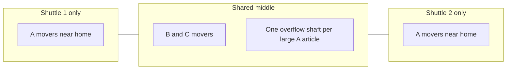

# Assignment strategy and design rationale

This note explains how Shaft Stock Distributor chooses how many shafts an article gets, where those shafts sit, and how the two shuttles pull them. Every rate below that is marked **example** is a hypothetical number used to test the formula. There is no measured customer inflow yet.

## The aisle

A row of flow racks. One rack is a segment. The example layout is 12 segments, 5 levels, 9 shafts on each level. Crates enter at the front and flow to the back. A shaft holds one article. When the crate count reaches crates-per-pallet plus a configurable offset, the shaft is pulled: the whole contents leave at the rear onto the conveyor, the shaft is empty, and it can be filled again (and, in automatic mode, reassigned).

```
front (inflow)                              rear (pulls, shuttle aisle)
  crates --> [ shaft ] [ shaft ] [ shaft ] --> conveyor
             level 5
             level 1                         shuttle moves in X and in level
```

Two shuttles share that rear aisle. Level does not let them pass each other. Travel time is the longer of the horizontal and vertical moves, because the axes run at the same time.



## How many shafts

Capacity is derived. It is not a fixed crate count.

```
capacity = floor(shaft length / (flow dimension + gap))
```

The flow dimension is the crate edge along the rack, chosen per article (length, width, or height). Gap defaults to 0. Optional clear width and clear height, when set, only produce a validation warning if the other two crate edges cannot fit in either rotation. They do not change capacity.

A pull starts at `trigger = crates per pallet + offset`. The crates that still fit after that are the headroom:

```
headroom = capacity - trigger
crates during the wait = inflow per hour * (expected wait seconds / 3600)
shafts = ceil(crates during the wait / headroom)
```

Special cases:

- Inflow of 0 requests 0 shafts.
- Capacity below the trigger requests 1 shaft and validation warns that a pull can never start.
- Headroom of 0 uses `ceil(crates during the wait)` so the stall is still visible.

**Example numbers (not a measurement).** A 20 m shaft and a 0.40 m crate with no gap hold `floor(20 / 0.40) = 50` crates. Pallet 40 plus offset 5 starts a pull at 45, so headroom is 5. At 600 crates/h and a 90 s expected wait, `600 * 90 / 3600 = 15` crates arrive. `ceil(15 / 5) = 3` shafts. That case is unit-tested.

The expected wait is a planning input (default 90 s). It is not the travel time to a particular shaft. If the real queue is longer than 90 s, the formula under-requests shafts and crates are lost while a pull is waiting. The scenario study is how you see that.

## Where the shafts go

Segments are split into thirds. `exclusive = segment count / 3`. The first exclusive segments are shuttle 1 only, the last exclusive segments are shuttle 2 only, and the middle (including any remainder) is shared. Fewer than 3 segments makes the whole aisle shared.

| Segments | Shuttle 1 only | Shared | Shuttle 2 only |
| --- | --- | --- | --- |
| 12 | 1–4 | 5–8 | 9–12 |
| 10 | 1–3 | 4–7 | 8–10 |
| 2 | — | 1–2 | — |

The constructive heuristic keeps pinned shafts, then clears everything else.

- **A movers**, highest inflow first. If the article needs 3 or more shafts, one shaft is placed in the shared middle so either shuttle can take an overflow pull. The rest are handed out one by one to the exclusive zone whose shuttle currently has less planned load, on the free shaft closest to that shuttle's home. Level 1 wins ties because the home is on level 1, so the vertical move is zero. If that zone is full, the shaft spills into the shared middle, then into the other exclusive zone.
- **B and C movers** prefer the shared middle, near the center of the aisle. If the middle is full they use the less-loaded exclusive zone, away from that shuttle's home, so fast movers keep the short trips.

Clustering every shaft of one article together shortens later travel between its pulls, and it also makes one shuttle own that article. Spreading an A article across both ends is what lets the two shuttles pull it in parallel. The heuristic does the second thing for A, and keeps B/C in the middle so they do not steal the best exclusive slots. One shared overflow shaft is the compromise: most A pulls stay on a home shuttle, and a burst can still be served by either.

The naive baseline ignores zones. It fills shafts from the left, in article order, using the same target counts. On the example warehouse that parks the fast movers on shuttle 1. Shuttle 2's planned load drops to about zero.

## How many shuttles, and how wide the overlap is

The aisle can hold from 1 shuttle up to one per segment. Shuttle numbers run left to right. Shuttle *n* cannot pass shuttle *n+1*. Each shuttle has its own speed (default 0.3 m/s on both axes) and its own home.

A shuttle serves an inclusive segment range. Where two neighbours both include a segment, that segment is shared: either of them may pull it, and the interlock keeps them apart. Every segment must belong to at least one range. The checker rejects a gap, a range that starts or ends outside the layout, a range that crosses the neighbour (the right-hand shuttle would have to pass), duplicate shuttle numbers, and homes that are out of order or closer than the safety distance.

**Two-shuttle thirds** is the preset that matches the table above. On 12 segments shuttle 1 serves 1–8 and shuttle 2 serves 5–12, homes at the two ends. Costs, zones, and the 55.1 pallets/h sample stay on that preset.

**Even split** is the default when you add or remove shuttles. Exclusive slices are as equal as the segment count allows. Each shuttle except the last then extends `overlap` segments into the next slice.

```
overlap = max(1, segmentCount / (3 × shuttleCount))    when there is more than one shuttle
```

On the 12-segment example that overlap is 1.

| Shuttles | Ranges | Shared segments |
| --- | --- | --- |
| 2 (thirds preset, not the even split) | 1–8 and 5–12 | 5–8 |
| 3 | 1–5, 5–9, 9–12 | 5 and 9 |
| 4 | 1–4, 4–7, 7–10, 10–12 | 4, 7, and 10 |

Homes for an even split are spaced from X = 0 to the far end of the aisle, so the outer shuttles still sit on the ends.

What that does to A, B, and C:

- **More shuttles** cut the aisle into more exclusive pockets. A movers are handed to whichever pocket's shuttle has less planned load, on the free shaft closest to that home. The same A article can sit on several homes, so more than two shuttles can pull it in parallel. Each pocket is shorter, which is why the shaft-to-shaft upper bound climbs (about 153 pallets/h for the pair, 334 for three shuttles, 507 for four, on the example crate mix). Each pocket also holds fewer shafts, so a fast mover spills into the overlap sooner.
- **A wider overlap** (the thirds preset shares four segments; the even split shares one per boundary) gives B and C a larger place to sit, and it gives an A article that needs three or more shafts a shared overflow shaft either neighbour can reach. It also means more pulls reserve a stretch the neighbour may need, so blocked time goes up before the travel saving does.
- **A narrower overlap** keeps almost every shaft exclusive. A movers stay on one home shuttle and rarely wait. B and C have to use the edge of an exclusive zone, farther from the middle, once the single shared segment is full.

On the example 1800 crates/h (offered 52.8 pallets/h, seed 1, 2.5 h with the first hour excluded, 400 optimizer iterations) the thirds pair achieves **55.1** pallets/h. Three shuttles achieve **50.2** and four achieve **51.3**. The load is already inside what two shuttles can clear, so the extra shuttles show up as a higher ceiling and lower utilization (about 32% / 32% for the pair, down to 15% / 6% / 4% / 9% for four), not as more pallets in this hour. Use another shuttle when the study says a shuttle is the thing that saturates, not when the offered line is already the limit.

## Travel, home, and handover

Each shuttle has its own horizontal speed, vertical speed, horizontal acceleration, and vertical acceleration. Defaults are 0.3 m/s and 0.2 m/s² on both axes. Zero acceleration is a constant speed. A positive acceleration uses a triangular profile when the hop is too short to reach top speed, and a trapezoid otherwise.

```
time = max(horizontal time, vertical time)
```

**Example.** 0.3 m at 0.3 m/s with 0.2 m/s² never reaches top speed. The time is `2 * sqrt(0.3 / 0.2)` seconds, about 2.45 s. A 3 m hop at 0.3 m/s with acceleration left at 0 takes 10 s.

Home defaults: shuttle 1 at X = 0, level 1; shuttle 2 at the far end of the aisle, level 1. Handover defaults to the same pose. The optimizer costs a pull as a round trip from **home**, plus the transfer duration (default 12 s), because the real handover pose is unknown. Charging travel back to a different handover would move the "short" shafts and could make level 1 less special. Until that pose is known, the desktop does not add a return-to-handover leg after a pull. The shuttle stays at the shaft it just served, which is also what the simulation does.

The example aisle is about 52.5 m (12 segments of 9 × 0.45 m, plus 11 gaps of 0.35 m). The chart's upper bound is not that home trip. A pull starts from the shaft the shuttle just served. For each shuttle the bound uses the mean travel time between every pair of shafts in the zone it may serve (its exclusive third plus the shared middle), adds the 12 s transfer, and multiplies by the most pallets one pull of a triggerable article can discharge. On the example that is about **153 pallets/h** for the pair. Shared-zone waiting is ignored, which only lowers real throughput, so a normal run stays under the line. The planner still scores a trip from home, because the handover pose is unknown; that cost is not the capacity line. At the example 1800 crates/h the shuttles are near 32% utilization.

## Cost and the search

Simulated annealing starts from the constructive assignment and never changes a pinned shaft. A move either swaps two unpinned shafts or moves an article onto an empty unpinned shaft. The project itself is not mutated until the caller accepts the result.

The cost is a weighted sum:

| Term | Meaning | Default weight |
| --- | --- | --- |
| Travel hours | Planned pulls times (hop from home + transfer), shared shafts charged to the nearer shuttle | 1.0 |
| Imbalance | `(max load − min load) / sum of loads`. With two shuttles that is `abs(load1 - load2) / (load1 + load2)` | 1.2 |
| Middle traffic | Fraction of planned pulls that sit in the shared zone | 0.8 |
| Penalty | Missing shafts, an article that can never pull, a shaft outside the layout | 4.0 |

Cooling defaults to 0.997. The desktop demo runs 180 iterations. The CLI sample and the comparison test run 400. The study re-optimizes with the iteration count on the study form (default 80 in the UI, 250 on the study request object if a caller leaves it there).

On the example warehouse those 400 iterations move the cost from **1.460** (naive: travel 0.260 h, imbalance 1.000) to **0.815** (travel 0.584 h, imbalance 0.082, middle traffic 0.165, penalty 0). Travel hours go up because work is deliberately sent to the far shuttle. Imbalance collapses. That trade is the point of the imbalance weight.

Limits of the search: it does not model queueing, the shared-aisle interlock, or the order of pulls. Two shafts can both look cheap from home and still block each other in the aisle. The scenario study is the check that includes those effects. Annealing can also stop short of a better layout; raising iterations is the first thing to try.

## Workload, dispatch, and the interlock

The simulation and the operation view share one controller.

1. A crate goes to the least-full assigned shaft that is not in transfer and still has room. Otherwise it is lost, and full shafts of that article are marked overflowing during the measured window.
2. Reaching the trigger enqueues a pull. Priority is near-full or overflowing first, then A before B before C, then age.
3. An exclusive shaft is offered only to its shuttle. A shared shaft is offered to the idle shuttle that may serve it and has less busy time. After a shared pull the preference moves to the other server of that segment, so one shuttle cannot camp in the overlap.
4. While a neighbour is blocked, a shuttle does not start a new pull in a shared segment that neighbour also serves. If it is sitting in that overlap, it moves aside. The aside target is its home when home is outside the overlap, otherwise the middle of its nearest exclusive segment. The path has to stay clear of the neighbour.
5. A moving shuttle reserves the X span it is sweeping, plus the safety distance (default 1.5 m). An idle shuttle reserves a point. A reservation that would leave two shuttles closer than the safety distance, or that would put a higher number to the left of a lower number, is rejected. Sitting exactly at the safety distance is allowed. Shuttles cannot pass.

Blocked time is counted separately from utilization. Utilization is travel plus transfer, divided by the measured window. Pull wait is the time from the trigger until transfer starts, so the transfer itself is not counted as waiting.

## Manual and automatic

The mode is stored on the project.

- **Manual** uses the stored assignment, including pins and later edits. Empty shafts stay with their article.
- **Automatic** starts from that assignment and remembers how many shafts each article was given, and the inflow that plan was sized for. It does nothing until the observation window (default 10 min) has a rate estimate. An empty unpinned shaft can move only when its article is clearly below that planned inflow, its other shafts are not packed, and it still has more shafts than the observed rate needs. The shaft is offered to an article that is short of the shaft-count formula, already losing crates, or sitting above about 72% full. A new score has to beat the current one by the hysteresis (default 25%). The shaft then waits 180 s, and the aisle allows at most 24 reassignments per hour. Pinned shafts never move. A shaft that still holds crates never changes article.

The mode switch asks for confirmation in the desktop window and does not change the project until you confirm. Pins set in the live view are kept across the switch.

Automatic is a correction for a mix that drifts away from the plan. It is not a second optimizer. On the planned example split (seed 1, 2.5 h, first hour excluded) it makes **no** reassignments, so the result matches manual: **55.1 pallets/h** against 52.8 offered, 8 lost crates, both shuttles near 32% utilization. The same optimized shafts with the inflow moved to 25/35/40, without a new plan, pull **68.9 pallets/h** and lose 71 crates in automatic mode, against **66.8 pallets/h** and 82 lost crates when the assignment is frozen. An earlier one-hour run with only 0.1 h of warm-up reported 42 pallets/h and, under the old policy, 21.7 pallets/h with 390 lost crates. That policy scored an empty shaft by how full its neighbors looked, so a pull handed a reserved shaft to another article. The 42-versus-53 gap was the shafts still filling up to the pull trigger, not the shuttle ceiling above.

## Reading the saturation chart

The study sweeps total crates/h for each named scenario. ABC shares (for example 70/20/10) split that total across classes, then class weight or a per-article weight splits the class. A weight of 0 means no inflow. Shares that do not sum to 1 are scaled and reported as a warning.

Each point is the mean of the replications. The chart draws achieved pallets/h as a solid line and offered pallets/h as a dashed line, one pair per scenario (and per mode, when you compare them). A white dashed horizontal line is the upper bound from the shaft-to-shaft cycle above. A red marker is the saturation load.

Defaults are 300 to 4000 crates/h in steps of 500, 3 replications, 2.5 h duration, and 1 h warm-up. A short window with no warm-up still looks empty, because the shafts have not reached the pull trigger.

A point is saturated when achieved pallets/h stays under 90% of offered (set the ratio to 0 to turn this off), or when either shuttle's utilization is above the optional ceiling. Lost crates count on their own only when the ratio rule is off. With the ratio rule on, a loss above 2% of inflow is named in the reason once throughput has already fallen off; a handful of crates while the curve still tracks offered does not set the knee. The knee is the first load where that point and every later point are saturated, and at least two points in a row are required. Max sustainable throughput is the achieved pallets/h of the previous point.

On the committed example sweep (`samples/example-study.csv`, both modes, re-optimized once per scenario):

| Scenario | Saturation | Sustainable pallets/h |
| --- | --- | --- |
| EXAMPLE balanced 70/20/10 | not reached by 4000 crates/h | 113.8 (still tracking offered) |
| EXAMPLE fast movers 85/10/5 | not reached by 4000 crates/h | 107.8 (still tracking offered) |
| EXAMPLE even mix 40/35/25 | 1800 crates/h | 43.4 |

Balanced and fast-mover curves stay with offered throughput through 4000 crates/h. The highest point on that sweep is 113.8 pallets/h, under the 153 pallets/h upper bound, with utilization about 60–68%. There is a dip around 800 crates/h on the balanced curve (about 20 achieved vs 23 offered) where few pulls fall inside the measured hour; the next loads recover, so it is not the knee. The even mix offers more pallets per crate, the shuttles flatten near 70 pallets/h, and the knee is 1800 crates/h. Automatic matches manual on these re-optimized plans. It is the shifted-split run in the previous section that shows automatic helping.

Recommended use of the splits: 70/20/10 when the catalog really is a few fast movers plus a long tail; 85/10/5 when almost all volume is A and you want to see whether the exclusive zones are enough; 40/35/25 when the mix is flat and middle-aisle traffic will dominate. Re-optimize once per scenario (the study does this by default) because the shaft counts depend on the split. Re-optimizing at every load point would hide the capacity limit of a single assignment; leave that off unless you are asking a different question.

## Open questions

- Where is home, and where is handover? Both are configurable. Travel back to handover is not applied.
- Is 0.3 m/s the right speed on each axis, and is 0.2 m/s² a fair acceleration?
- Is 12 s a fair transfer, and does a pull really discharge the whole shaft?
- What does real inflow look like? The simulation is a capacity study driven by Poisson arrivals at the scenario rates.
- Which PLC protocol should the hardware adapter speak? The stub names OPC UA, S7, and TCP, and `SendPullJob` throws until one is chosen.
- Should a published plan be re-optimized at every load point, or only when the ABC split changes? The study does the second.
