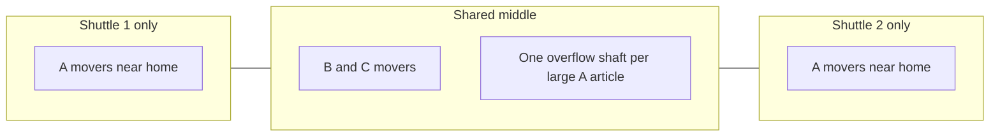

# Assignment strategy and design rationale

This note explains how Shaft Stock Distributor chooses how many shafts an article gets, where those shafts sit, and how the two shuttles pull them. Every rate below that is marked **example** is a hypothetical number used to test the formula. There is no measured customer inflow yet.

## The aisle

A row of flow racks. One rack is a segment. The example layout is 12 segments, 5 levels, 9 shafts on each level. Crates enter at the front and flow to the back. A shaft holds one article. When the crate count reaches crates-per-pallet plus a configurable offset, the shaft is pulled: the whole contents leave at the rear onto the conveyor, the shaft is empty, and it can be filled again (and, in automatic mode, reassigned).

```
front (inflow)                              rear (pulls, shuttle aisle)
  crates --> [ shaft ] [ shaft ] [ shaft ] --> conveyor
             level 5
             level 1                         shuttle moves in X and in level
```

Two shuttles share that rear aisle. Level does not let them pass each other. Travel time is the longer of the horizontal and vertical moves, because the axes run at the same time.



## How many shafts

Capacity is derived. It is not a fixed crate count.

```
capacity = floor(shaft length / (flow dimension + gap))
```

The flow dimension is the crate edge along the rack, chosen per article (length, width, or height). Gap defaults to 0. Optional clear width and clear height, when set, only produce a validation warning if the other two crate edges cannot fit in either rotation. They do not change capacity.

A pull starts at `trigger = crates per pallet + offset`. The crates that still fit after that are the headroom:

```
headroom = capacity - trigger
crates during the wait = inflow per hour * (expected wait seconds / 3600)
shafts = ceil(crates during the wait / headroom)
```

Special cases:

- Inflow of 0 requests 0 shafts.
- Capacity below the trigger requests 1 shaft and validation warns that a pull can never start.
- Headroom of 0 uses `ceil(crates during the wait)` so the stall is still visible.

**Example numbers (not a measurement).** A 20 m shaft and a 0.40 m crate with no gap hold `floor(20 / 0.40) = 50` crates. Pallet 40 plus offset 5 starts a pull at 45, so headroom is 5. At 600 crates/h and a 90 s expected wait, `600 * 90 / 3600 = 15` crates arrive. `ceil(15 / 5) = 3` shafts. That case is unit-tested.

The expected wait is a planning input (default 90 s). It is not the travel time to a particular shaft. If the real queue is longer than 90 s, the formula under-requests shafts and crates are lost while a pull is waiting. The scenario study is how you see that.

## Where the shafts go

Segments are split into thirds. `exclusive = segment count / 3`. The first exclusive segments are shuttle 1 only, the last exclusive segments are shuttle 2 only, and the middle (including any remainder) is shared. Fewer than 3 segments makes the whole aisle shared.

| Segments | Shuttle 1 only | Shared | Shuttle 2 only |
| --- | --- | --- | --- |
| 12 | 1–4 | 5–8 | 9–12 |
| 10 | 1–3 | 4–7 | 8–10 |
| 2 | — | 1–2 | — |

The constructive heuristic keeps pinned shafts, then clears everything else.

- **A movers**, highest inflow first. If the article needs 3 or more shafts, one shaft is placed in the shared middle so either shuttle can take an overflow pull. The rest are handed out one by one to the exclusive zone whose shuttle currently has less planned load, on the free shaft closest to that shuttle's home. Level 1 wins ties because the home is on level 1, so the vertical move is zero. If that zone is full, the shaft spills into the shared middle, then into the other exclusive zone.
- **B and C movers** prefer the shared middle, near the center of the aisle. If the middle is full they use the less-loaded exclusive zone, away from that shuttle's home, so fast movers keep the short trips.

Clustering every shaft of one article together shortens later travel between its pulls, and it also makes one shuttle own that article. Spreading an A article across both ends is what lets the two shuttles pull it in parallel. The heuristic does the second thing for A, and keeps B/C in the middle so they do not steal the best exclusive slots. One shared overflow shaft is the compromise: most A pulls stay on a home shuttle, and a burst can still be served by either.

The naive baseline ignores zones. It fills shafts from the left, in article order, using the same target counts. On the example warehouse that parks the fast movers on shuttle 1. Shuttle 2's planned load drops to about zero.

## Travel, home, and handover

Each shuttle has its own horizontal speed, vertical speed, horizontal acceleration, and vertical acceleration. Defaults are 0.3 m/s and 0.2 m/s² on both axes. Zero acceleration is a constant speed. A positive acceleration uses a triangular profile when the hop is too short to reach top speed, and a trapezoid otherwise.

```
time = max(horizontal time, vertical time)
```

**Example.** 0.3 m at 0.3 m/s with 0.2 m/s² never reaches top speed. The time is `2 * sqrt(0.3 / 0.2)` seconds, about 2.45 s. A 3 m hop at 0.3 m/s with acceleration left at 0 takes 10 s.

Home defaults: shuttle 1 at X = 0, level 1; shuttle 2 at the far end of the aisle, level 1. Handover defaults to the same pose. The optimizer costs a pull as a round trip from **home**, plus the transfer duration (default 12 s), because the real handover pose is unknown. Charging travel back to a different handover would move the "short" shafts and could make level 1 less special. Until that pose is known, the desktop does not add a return-to-handover leg after a pull. The shuttle stays at the shaft it just served, which is also what the simulation does.

## Cost and the search

Simulated annealing starts from the constructive assignment and never changes a pinned shaft. A move either swaps two unpinned shafts or moves an article onto an empty unpinned shaft. The project itself is not mutated until the caller accepts the result.

The cost is a weighted sum:

| Term | Meaning | Default weight |
| --- | --- | --- |
| Travel hours | Planned pulls times (hop from home + transfer), shared shafts charged to the nearer shuttle | 1.0 |
| Imbalance | `abs(load1 - load2) / (load1 + load2)` | 1.2 |
| Middle traffic | Fraction of planned pulls that sit in the shared zone | 0.8 |
| Penalty | Missing shafts, an article that can never pull, a shaft outside the layout | 4.0 |

Cooling defaults to 0.997. The desktop demo runs 180 iterations. The CLI sample and the comparison test run 400. The study re-optimizes with the iteration count on the study form (default 80 in the UI, 250 on the study request object if a caller leaves it there).

On the example warehouse those 400 iterations move the cost from **1.460** (naive: travel 0.260 h, imbalance 1.000) to **0.815** (travel 0.584 h, imbalance 0.082, middle traffic 0.165, penalty 0). Travel hours go up because work is deliberately sent to the far shuttle. Imbalance collapses. That trade is the point of the imbalance weight.

Limits of the search: it does not model queueing, the shared-aisle interlock, or the order of pulls. Two shafts can both look cheap from home and still block each other in the aisle. The scenario study is the check that includes those effects. Annealing can also stop short of a better layout; raising iterations is the first thing to try.

## Workload, dispatch, and the interlock

The simulation and the operation view share one controller.

1. A crate goes to the least-full assigned shaft that is not in transfer and still has room. Otherwise it is lost, and full shafts of that article are marked overflowing during the measured window.
2. Reaching the trigger enqueues a pull. Priority is near-full or overflowing first, then A before B before C, then age.
3. An exclusive shaft is offered only to its shuttle. A shared shaft is offered to the idle shuttle with less busy time, with a preference that flips after each shared assignment so one shuttle cannot camp in the middle.
4. While one shuttle is blocked, the other does not start a new shared pull. If it is sitting inside the shared span, it yields home so the blocked shuttle can leave.
5. A moving shuttle reserves the X span it is sweeping, plus the safety distance (default 1.5 m). An idle shuttle reserves a point. A reservation that would leave the shuttles closer than the safety distance is rejected. Sitting exactly at the safety distance is allowed.

Blocked time is counted separately from utilization. Utilization is travel plus transfer, divided by the measured window. Pull wait is the time from the trigger until transfer starts, so the transfer itself is not counted as waiting.

## Manual and automatic

The mode is stored on the project.

- **Manual** uses the stored assignment, including pins and later edits. Empty shafts stay with their article.
- **Automatic** starts from that assignment. At runtime it may point an **empty** shaft at the article that currently needs capacity most (observed inflow over the window, fill of the other shafts, ABC class). Pinned shafts never move. A shaft that still holds crates never changes article. A switch has to score at least 25% better than the current article (hysteresis), then the shaft waits 180 s, and the aisle allows at most 24 reassignments per hour.

The mode switch asks for confirmation in the desktop window and does not change the project until you confirm. Pins set in the live view are kept across the switch.

Automatic is a correction for inflow that drifts away from the plan. On the example hour it is not a better plan than the optimizer. With the optimized assignment frozen (manual), one seeded hour at the example 1800 crates/h pulled **42.4 pallets/h** (offered 52.8, 6 lost crates, both shuttles working). The same hour in automatic mode pulled **21.7 pallets/h** and lost 390 crates: empty shafts were retargeted toward whichever article looked fullest, and the fast movers lost the parallel shafts the planner had given them. Use automatic when the live mix is moving. Use manual when you want the study to measure the plan you just optimized.

## Reading the saturation chart

The study sweeps total crates/h for each named scenario. ABC shares (for example 70/20/10) split that total across classes, then class weight or a per-article weight splits the class. A weight of 0 means no inflow. Shares that do not sum to 1 are scaled and reported as a warning.

Each point is the mean of the replications. The chart draws achieved pallets/h as a solid line and offered pallets/h as a dashed line, one pair per scenario (and per mode, when you compare them). A red marker is the saturation load.

A point is saturated when any of these hold:

- Achieved pallets/h is under 98% of offered (set the ratio to 0 to turn this off).
- Any crate was lost (this rule can be turned off).
- Either shuttle's utilization is above the optional ceiling (blank means off).

Saturation is the first load where that point **and every later point** are saturated. Max sustainable throughput is the achieved pallets/h of the previous point, or 0 when the first point is already saturated.

On the example warehouse the strict rules fire at the first load (600 crates/h) for every scenario in the committed sample sweep. Two things cause that, and both are visible in `samples/example-study.csv`:

- A short measured window still includes fill-up. At 600 crates/h a shaft may not reach the pull trigger inside a 0.5 h run, so achieved pallets/h is far below offered even though nothing is wrong with the shuttles.
- A handful of lost crates is enough to trip the lost-crate rule. The longer 2 h run with a 1 h warm-up (not committed; rerun with `--hours 2 --warmup 1`) still loses a few crates at 600/h, so the detector still reports sustainable throughput 0.

Read the curves, not only the marker. With the optimized assignment held fixed and a 1 h warm-up, manual mode on **EXAMPLE balanced 70/20/10** stays near the offered line through 2400 crates/h (about 71 achieved vs 70 offered) and is still close at 3600 (101 vs 106) while lost crates rise. **EXAMPLE fast movers 85/10/5** tracks offered through 1800 crates/h with almost no loss; the shuttles are busy with fewer, larger A pulls. **EXAMPLE even mix 40/35/25** offers more pallets per crate hour because B and C have fewer crates per pallet, and lost crates climb earlier. Automatic mode sits well below its offered line in all three, for the reason in the previous section.

Recommended use of the splits: 70/20/10 when the catalog really is a few fast movers plus a long tail; 85/10/5 when almost all volume is A and you want to see whether the exclusive zones are enough; 40/35/25 when the mix is flat and middle-aisle traffic will dominate. Re-optimize once per scenario (the study does this by default) because the shaft counts depend on the split. Re-optimizing at every load point would hide the capacity limit of a single assignment; leave that off unless you are asking a different question.

## Open questions

- Where is home, and where is handover? Both are configurable. Travel back to handover is not applied.
- Is 0.3 m/s the right speed on each axis, and is 0.2 m/s² a fair acceleration?
- Is 12 s a fair transfer, and does a pull really discharge the whole shaft?
- What does real inflow look like? The simulation is a capacity study driven by Poisson arrivals at the scenario rates.
- Which PLC protocol should the hardware adapter speak? The stub names OPC UA, S7, and TCP, and `SendPullJob` throws until one is chosen.
- Should a published plan be re-optimized at every load point, or only when the ABC split changes? The study does the second.
