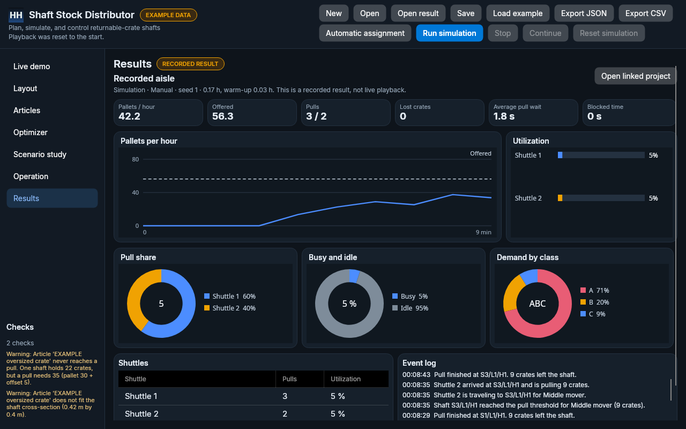

# Simulation results

Configure a warehouse in the desktop app (or start from `samples/example-warehouse.json`), run it in the console, then open the result file in the desktop app. The Results page draws the recorded numbers. It does not simulate again.



## Write a result

```bash
dotnet run --project src/ShaftStockDistributor.Cli -- simulate --project samples/example-warehouse.json --hours 2.5 --warmup 1 --seed 1 --mode Manual --out-result samples/example-run.ssdresult.json
```

`--out-result` is optional. Without it, `simulate` only prints the summary, as before.

A capacity study can write the same kind of file, and it still writes the CSV when you pass `--csv`:

```bash
dotnet run --project src/ShaftStockDistributor.Cli -- study --project samples/example-warehouse.json --compare-modes --csv samples/example-study.csv --out-result samples/example-study.ssdresult.json
```

## Open it

**Open result** in the header accepts `*.ssdresult.json` and `*.json`. It stays available while playback is running or paused, and it does not replace the project you are editing. The Results page then shows a badge, **RECORDED RESULT**, and the line “This is a recorded result, not live playback.”

**Open linked project** loads the project stored in the file and opens Live demo. Editing that project does not change the result file. Save the project yourself if you want a new JSON, then run the console again to record a new result.

## What the dashboard draws

The file decides which charts appear.

| Chart | Simulation file | Study file |
| --- | --- | --- |
| Pallets per hour, with offered as a dashed line | Steady rate sampled about once a minute. Early points can still be the cumulative rate, until the 20-minute window has elapsed. | Hidden. A study has no time series. |
| Utilization | One bar per shuttle. | One bar per shuttle, from the headline mean (the load with the highest achieved pallets per hour). Pull counts are zero, because a study point does not store pulls. |
| Pull share | Donut of pulls per shuttle. | A gray “No pulls” ring, for the same reason. |
| Busy and idle | Donut of average shuttle utilization against the rest. | Same, from the headline mean. |
| Demand by class | Donut of class A, B, and C crate inflow in the stored project. | Same, from the stored project. |
| Achieved and lost crates | Hidden. | Solid lines are achieved pallets per hour. Dashed lines are lost crates, on the right axis, against load. |

KPI cards show achieved and offered pallets per hour, pulls, lost crates, average pull wait, and blocked time. A study file’s headline is the mean with the highest achieved pallets per hour. The means table and saturation cards list the rest of the sweep.

## File format

`ssdresult` version 1. JSON, camelCase, one file, so Open result works without the original project beside it.

| Field | Contents |
| --- | --- |
| `format`, `version`, `kind` | `ssdresult`, `1`, and either `simulation` or `study`. |
| `createdUtc` | When the file was written. |
| `project.name`, `project.sourcePath`, `project.sha256` | Name, the path passed to `--project`, and the SHA-256 of the embedded project JSON. |
| `project.snapshot` | The project document, schema version 1, embedded as JSON. |
| `run` | Seed, duration and warm-up in hours, assignment mode, scenario name, and the 20-minute sample window. |
| `summary` | Offered and achieved pallets per hour, pallet counts, measured hours, wait, blocked time, lost crates, overflow, reassignments, and one `{ number, pulls, utilization }` per shuttle. |
| `series` | `{ timeHours, steadyPalletsPerHour, warmingUp }`. Empty for a study. |
| `events`, `pullsByShaft`, `lostCratesByArticle` | Present for a simulation. A study leaves the lists empty. |
| `study` | Omitted for a simulation. A study stores `theoreticalPalletsPerHour`, `points`, `means`, and `saturations`. |

A file with another `format`, or a `version` other than 1, is refused.
